# StarRocks Admin UI

[](LICENSE)

A modern React dashboard for managing StarRocks clusters. Provides multi-environment SQL querying, schema browsing, ingestion management (routine load, batch load, scheduled tasks and pipes), materialized views, query monitoring, and cluster health overview.

<picture>
  <source media="(prefers-color-scheme: dark)" srcset="docs/screenshots/query-console-dark.png">
  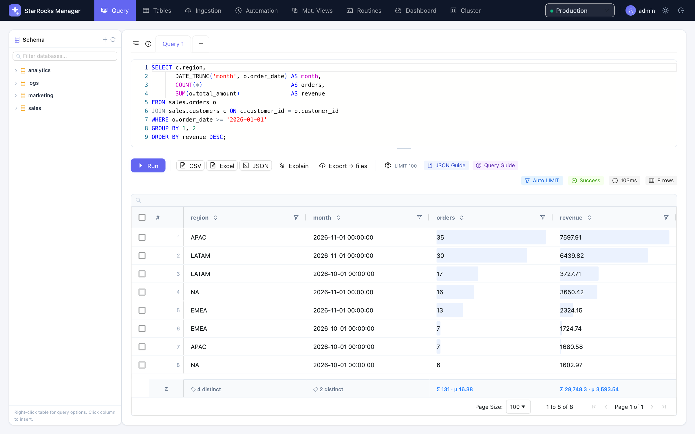
</picture>

> [!IMPORTANT]
> **This repository is only the front end.** The UI depends on the backend, [starrocks-api](https://github.com/PttemDev/starrocks-api), and does not work without it. Sign-in, queries and every other feature call that API. Start the API first (see the [Quick start](#quick-start)).

## Features

All screenshots show fictional demo data.

### Query Console

- Monaco-based SQL editor with keyword + schema autocomplete
- Schema tree sidebar; right-click a table for `SELECT` templates or to open it in **Tables**
- Resizable editor area and per-environment query tabs (each environment keeps its own tab list)
- Streaming NDJSON results in AG Grid, with a summary row (distinct count, sum, mean) per column
- Cell and row actions: copy value, copy row as JSON, copy as SQL literal, pin columns, JSON viewer
- Export results as CSV, Excel or JSON, or write them to object storage (S3/GCS) as Parquet, ORC or CSV (`INSERT INTO FILES`)
- Query plan viewer: `EXPLAIN`, or `EXPLAIN ANALYZE` for a runtime profile
- Auto `LIMIT` for `SELECT` queries that have none, so a stray query can't freeze the browser
- Session variables (`SET key=value`) applied per connection before each query, useful for optimizer hints like `enable_topn_opt` and `query_timeout`
- Query history with duration, row count and status; built-in StarRocks query and JSON function guides

### Tables

- Browse one database or all of them: object type (table, view, materialized view), rows, data size, average row size, created/updated time, comment
- Table detail: the `CREATE` statement (copy it to recreate the table in another environment), columns, and partitions (add or drop)
- Add column, collect optimizer statistics (`ANALYZE TABLE`), drop table with confirmation
- Create database, and a create table wizard (Duplicate, Primary or Aggregate key, partitioning, distribution)

<table>
  <tr>
    <td width="50%">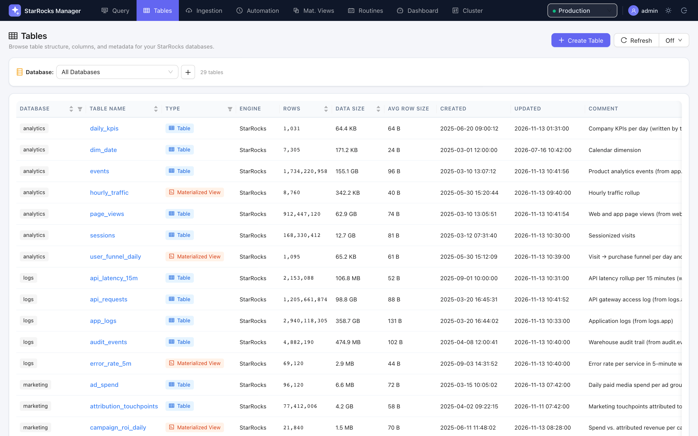</td>
    <td width="50%">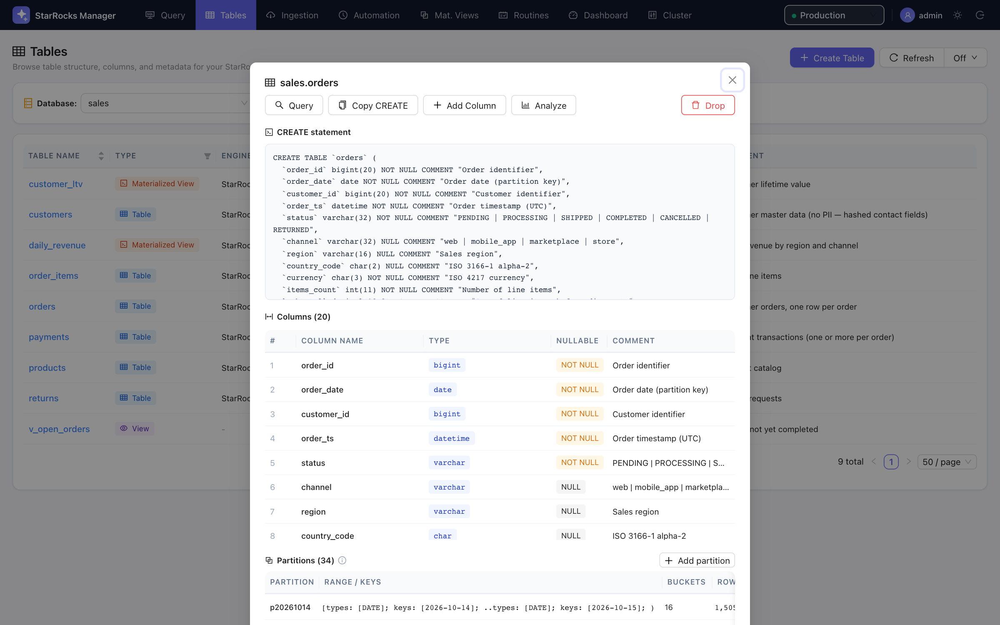</td>
  </tr>
</table>

### Ingestion

- **Routine Load:** Kafka jobs across all databases, filterable by database, table and state, with consumer lag, last message time, loaded/error rows and task count. Create, pause, resume and stop jobs.
- **Routine load detail:** per-partition consumed and latest offsets with lag, throughput statistics and job properties. Change settings in place (the backend runs `PAUSE → ALTER → RESUME` and rolls back a failed `ALTER`), or copy the SQL to re-create the job.
- **Batch Load:** S3/MinIO, Google Cloud Storage, HDFS, Table-to-Table (`INSERT INTO ... SELECT`) and file upload (HTTP Stream Load)
- **Batch load wizard** in five steps: Source → Target & Format → Preview & Schema → Options → Review. Preview the files and infer their schema with `FILES()`, then create the target table from it. Run the load once, on a schedule, or continuously as a pipe.
- Job monitoring with progress bars, state and type tags, ETL info and cancel actions

<table>
  <tr>
    <td width="50%">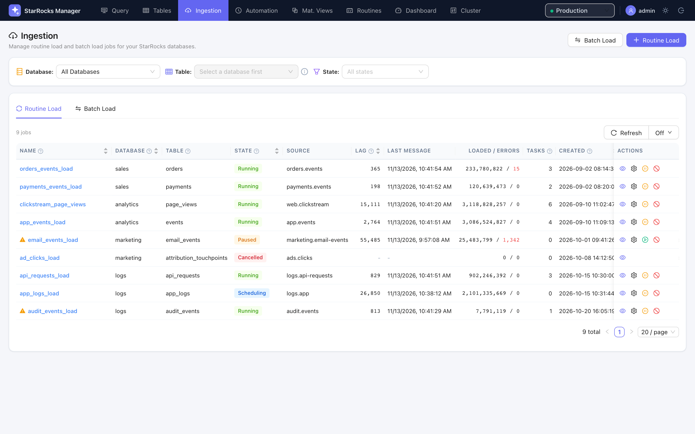</td>
    <td width="50%">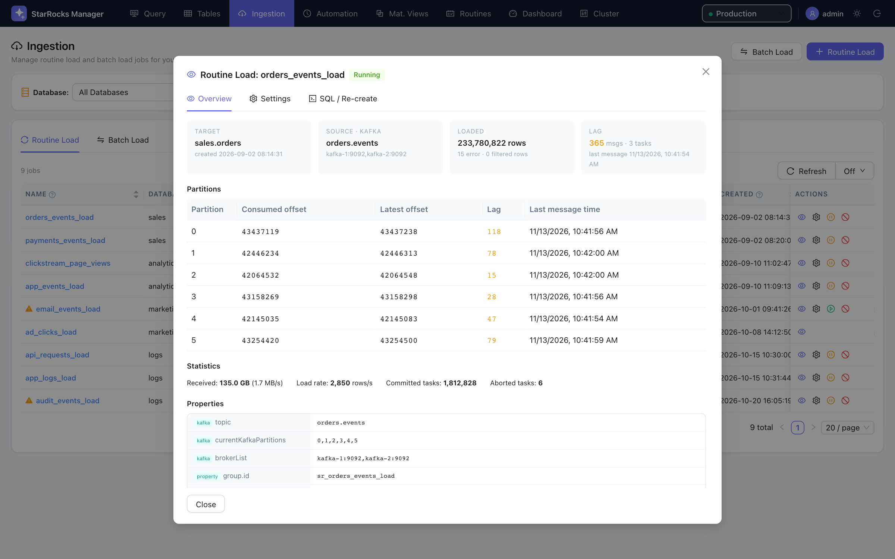</td>
  </tr>
  <tr>
    <td width="50%">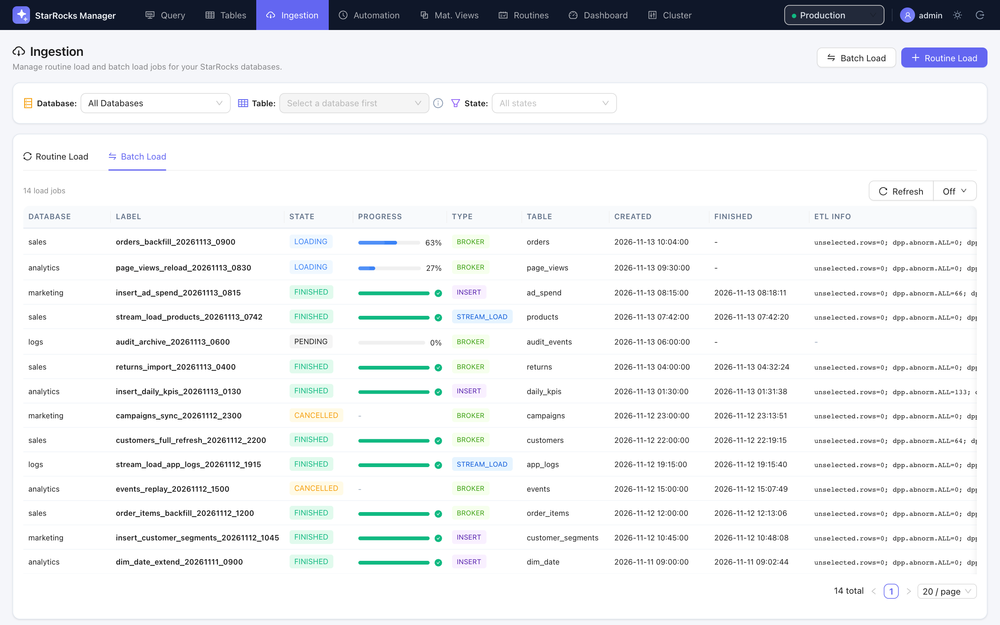</td>
    <td width="50%">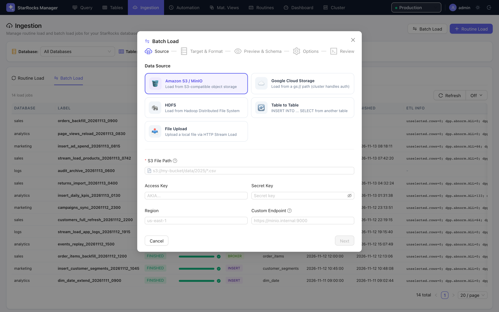</td>
  </tr>
</table>

### Automation

StarRocks-native recurring ingestion, with no external scheduler:

- **Scheduled tasks** (`SUBMIT TASK ... SCHEDULE`): view and edit the SQL, see run history, run now, drop
- **Pipes** (continuous, deduplicated file ingestion): list loaded files, suspend/resume, edit auto-ingest and poll interval, retry errored files, drop
- One list for both, filtered by all, active (running/skipped) or finished (success/failed)

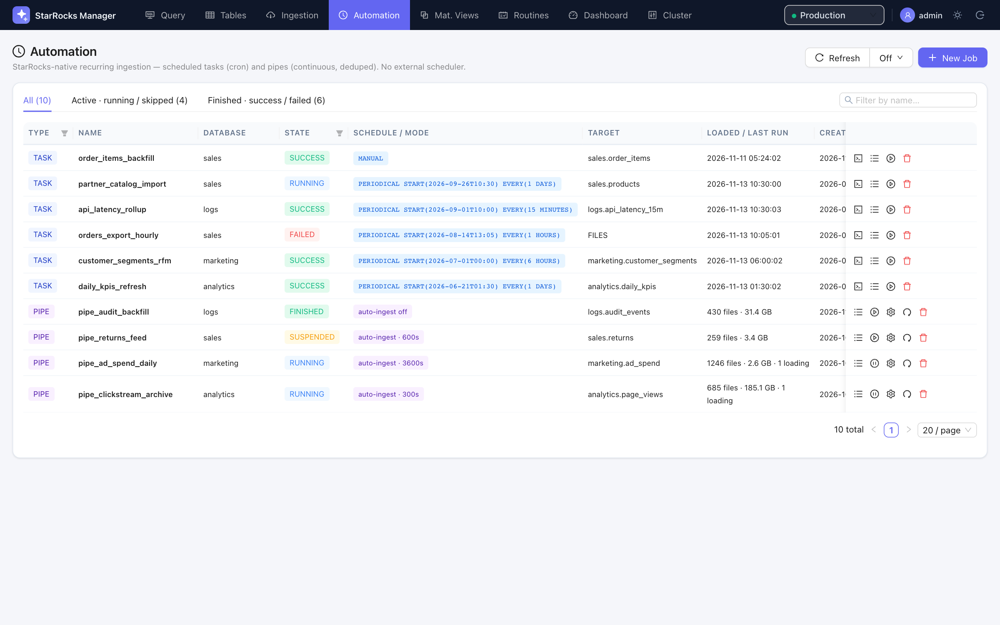

### Materialized Views

- Refresh type, active state, last refresh status and time, row count
- View the definition, refresh now (async), create, drop

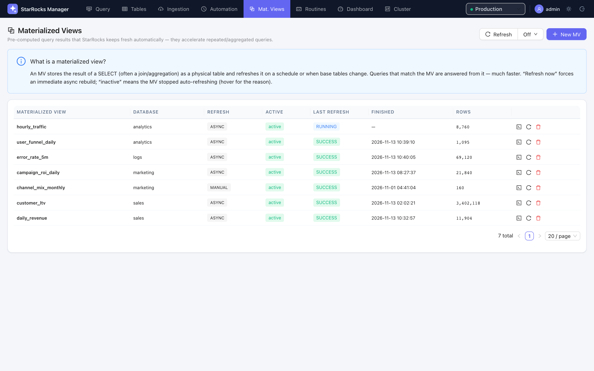

### Routines

- Every routine load job in the environment on one page, with counts per state
- Flags jobs that need attention: paused by the system, or reporting task errors such as an unreachable broker

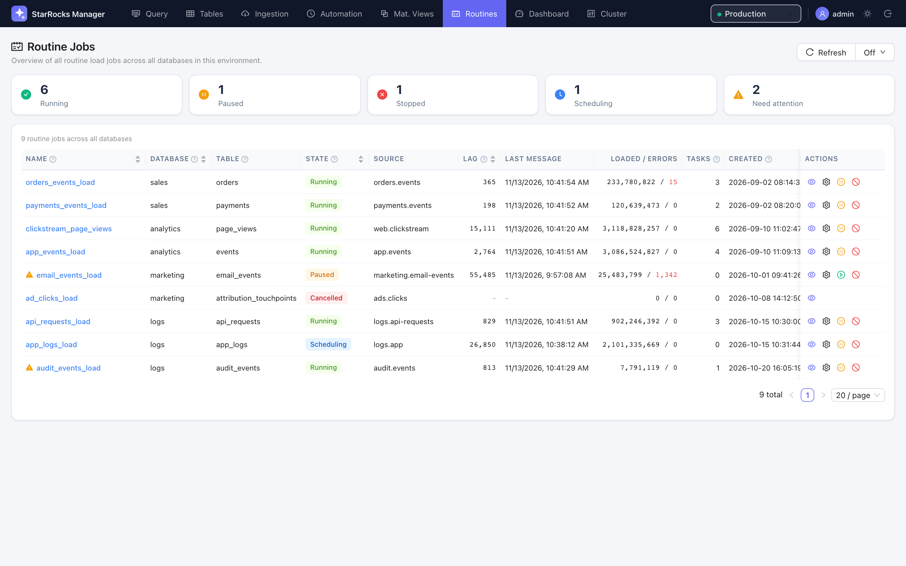

### Dashboard

- **Cluster:** total, alive and dead nodes, storage used/total, plus backend and frontend node tables (capacity, disk and memory usage, tablets, running queries, version, heartbeat)
- Admin actions on frontend nodes: register a node as `FOLLOWER`, or drop and re-add it
- **Query Monitor:** running queries with CPU time, memory, scanned rows/bytes and progress; kill a query; slow query log

<table>
  <tr>
    <td width="50%">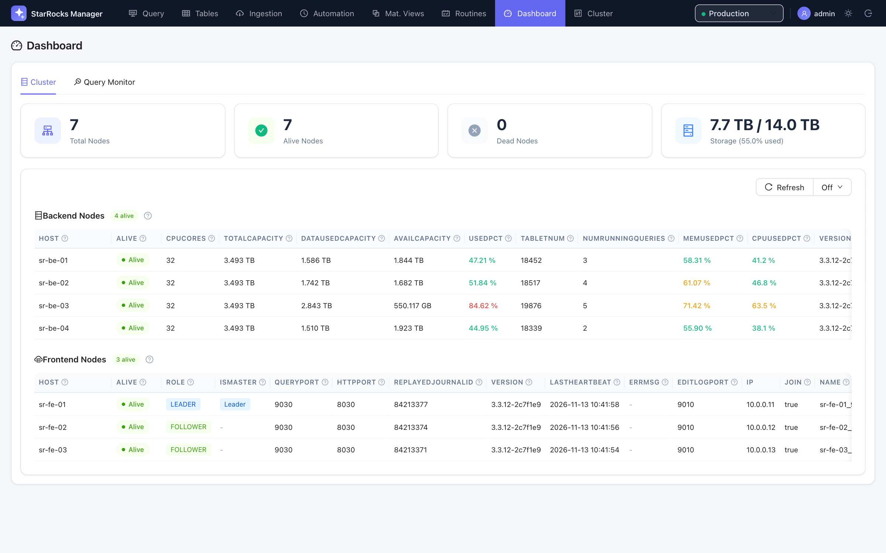</td>
    <td width="50%">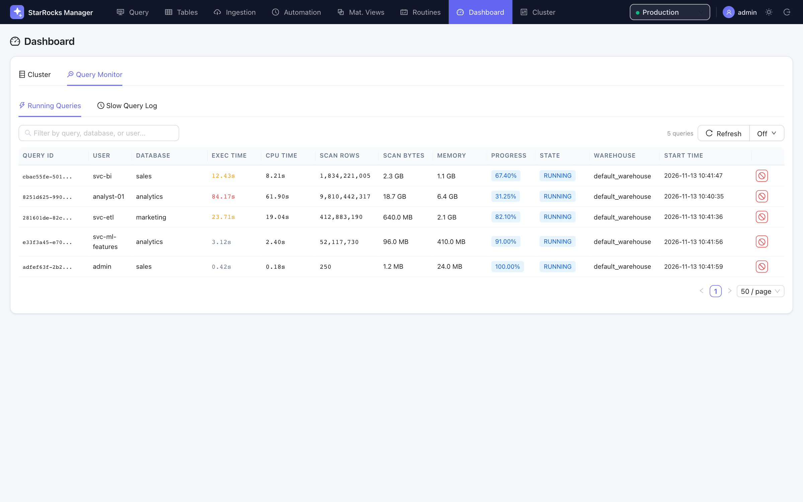</td>
  </tr>
</table>

### Cluster

- Read-only, filterable views of system variables, FE configuration, catalogs (internal and external) and resource groups

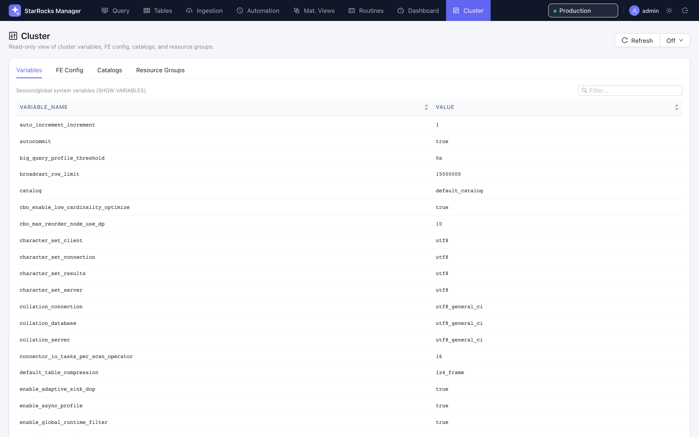

### General

- Multiple environments with a switcher; environments marked read-only are labelled in the UI
- Login with username/password; the token is persisted in localStorage
- Role-based UI: admins see write actions, viewers get read-only pages
- Light, dark or system theme
- Auto-refresh (off, 5s, 10s, 30s or 1m) on every list and monitoring page

## Tech Stack

- **React 19** + **TypeScript 6**
- **Vite 8** (dev server + build)
- **Ant Design 6** (UI components)
- **Monaco Editor** (SQL editor with autocomplete)
- **AG Grid** (query result tables)
- **Recharts** (dashboard charts)
- **Zustand** (state management with persistence)

## Quick Start

You run two things: the backend ([starrocks-api](https://github.com/PttemDev/starrocks-api)) and this UI. Clone both repositories.

**1. Backend** (listens on `127.0.0.1:8081` by default)

```bash
cd starrocks-api
cp config.example.json config.json   # edit with your StarRocks hosts, credentials and tokens
go build -o bin/server .
./bin/server -config config.json
```

**2. UI**

```bash
cd starrocks-admin-ui
npm ci
npm run dev
```

Opens at `http://localhost:5173`. The dev server proxies `/api` requests to the backend at `http://127.0.0.1:8081`. To use another backend address, set `VITE_PROXY_TARGET`:

```bash
VITE_PROXY_TARGET=http://127.0.0.1:9000 npm run dev
```

Sign in with a user from the `login_users` section of the backend's `config.json`. The values in `config.example.json` are placeholders; change them before you expose anything.

## Docker

```bash
# Build
docker build -t starrocks-admin-ui .

# Run, pointing nginx at your backend
docker run -d -p 8080:80 --name starrocks-admin-ui \
  -e API_BACKEND_URL=http://starrocks-api:8081 \
  starrocks-admin-ui
```

The image uses nginx to serve the built SPA and proxy `/api/*` requests to the backend. Set `API_BACKEND_URL` to the address where the container can reach [starrocks-api](https://github.com/PttemDev/starrocks-api). The default is `http://backend:8081`.

The image only serves the static UI. Without a reachable backend, sign-in and all data features will not work.

For more control, mount your own nginx config:

```bash
docker run -d -p 8080:80 \
  -v $(pwd)/nginx.conf:/etc/nginx/templates/default.conf.template:ro \
  starrocks-admin-ui
```

## Build

```bash
npm run build    # outputs to dist/
npm run preview  # preview the production build locally
```

By default the UI calls `/api` on the same origin. Set `VITE_API_URL` at build time to call a backend on another origin (the backend must then allow your UI origin in `server.cors_origins`). `VITE_*` values are baked into the public bundle, so never put secrets in them.

## Project Structure

```
starrocks-admin-ui/
├── src/
│   ├── api/           # API client functions and types
│   ├── components/
│   │   ├── Automation/        # Scheduled tasks + pipes
│   │   ├── Cluster/           # Variables, FE config, catalogs, resource groups
│   │   ├── Dashboard/         # Cluster health overview + query monitor tab
│   │   ├── Ingestion/         # Routine load + batch load management and wizards
│   │   ├── Layout/            # App shell, top menu, env switcher, theme toggle
│   │   ├── Login/             # Authentication page
│   │   ├── MaterializedViews/ # Materialized view list, create, refresh
│   │   ├── Queries/           # Running queries, slow query log, kill query
│   │   ├── QueryConsole/      # SQL editor, results, tabs, history, explain, export
│   │   ├── Routines/          # All routine load jobs across databases
│   │   ├── Scheduler/         # Scheduled task detail / edit modal
│   │   ├── Tables/            # Table browser, create table, add column, partitions
│   │   └── shared/            # Reusable components (AutoRefresh, RoutineLoadTable)
│   ├── hooks/         # Custom hooks (useStreamingQuery, useExport, useTheme)
│   ├── store/         # Zustand stores (auth, env, query tabs, history, schema, settings)
│   ├── styles/        # Global CSS
│   └── utils/         # SQL completion, helpers
├── docs/screenshots/  # README screenshots
├── nginx.conf         # Production nginx config (used in Docker)
├── vite.config.ts     # Vite dev server + proxy config
└── Dockerfile
```

## Security

Checks run before the initial public release (November 2026):

- [x] `npm run build` (`tsc && vite build`) passes
- [x] The UI was run against the backend end to end (dev server proxy and the Docker images): sign-in, rejected wrong password and rejected unauthenticated query
- [x] Source tree and production bundle scanned for committed secrets, `.env` files and internal hostnames; none found
- [x] `npm audit` reports no critical or high severity advisories
- [ ] `npm audit` still reports 2 moderate advisories in `react-router-dom` 6.x (open-redirect issues fixed in 7.x, which is a major upgrade). See [SECURITY.md](SECURITY.md).
- [ ] The project has **no automated tests** and no lint configuration yet

`package.json` uses `overrides` to pin a patched `dompurify`, which `monaco-editor` otherwise pulls in at an older, vulnerable version.

These checks are a point-in-time snapshot, not a security audit. Run `npm audit` regularly. To report a vulnerability, see [SECURITY.md](SECURITY.md).

## Contributing

Contributions are welcome. See [CONTRIBUTING.md](CONTRIBUTING.md).

## License

MIT. See [LICENSE](LICENSE).
